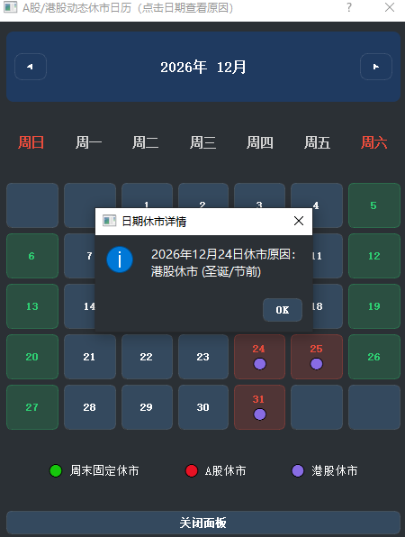
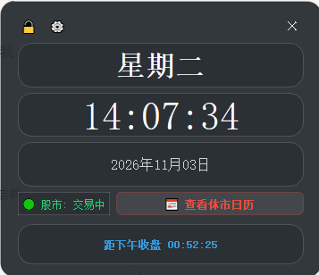

# A股/港股交易日历桌面时钟 (Desktop Clock)

一个专为 A 股与港股投资者打造的精美 Windows 桌面悬浮时钟应用。不仅提供精确的本地时间与星期置顶，更深度集成股市交易日历，助你随时掌握开盘与休市状态。

## 🚀 核心功能特点

- 🕒 **精准悬浮时钟**：支持毛玻璃半透明外观、窗口置顶与系统托盘后台运行，随时随地掌握时间。
- 📈 **股市交易状态提示**：专为 A 股与港股股民设计，实时显示当前是否为交易日及盘中时段。
- 📅 **交易日历集成**：清晰标注节假日、周末与休市安排，避免错过重要交易节点。
- 📌 **星期与盘面置顶**：常驻桌面，一眼即可了解盘前准备或盘中倒计时。

## 📸 软件界面展示

| 界面预览 1 | 界面预览 2 |
| :---: | :---: |
|  |  |

## 📦 安装与运行

### 1. 软件下载与安装
你可以直接在仓库右侧的 **Releases** 页面下载最新打包好的安装程序 `clock_app2027.exe` 进行安装体验。

### 2. 开发环境运行
如果你想查看或修改源码：
```bash
# 安装依赖
npm install

# 启动应用
npm start
### 3. 打包为安装包
```bash
# 生成安装程序
npm run dist
## 📄 开源许可证
本项目基于 MIT License 开源许可。
